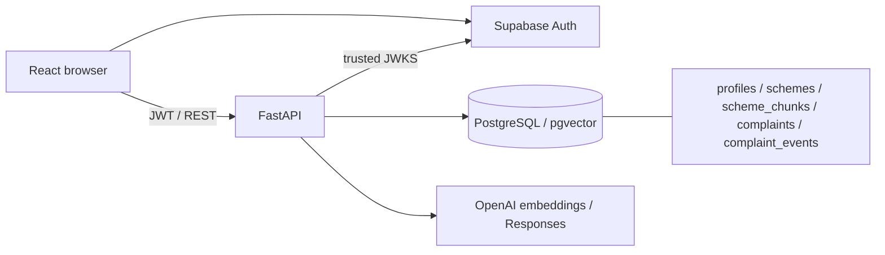

# JanSeva AI

An independent citizen-assistance portfolio project: discover public schemes with cited evidence, create internal civic complaints, and review their history with an assigned officer. JanSeva does not file government grievances or verify government resolution.

**Release status (2026-11-07): local verification passes; live-provider verification is blocked by missing configuration.** This is a controlled demo candidate, not an approved public production release. See the [current bug audit](docs/bug-audit.md), [Phase 5 release review](docs/release-review.md) and [implementation status](docs/implementation-status.md).

## Technology and architecture

- Frontend: React 19, JavaScript, Vite 8, React Router, existing CSS/Tailwind utilities, Lucide icons and Supabase JavaScript client.
- Backend: Python, FastAPI, Pydantic, SQLAlchemy 2, psycopg, PyJWT and httpx.
- Services: PostgreSQL with pgvector, Supabase Auth with asymmetric signing keys, and OpenAI embeddings/Responses through server-side HTTP calls. No LangChain or separate vector database.
- Tests: pytest, Node test runner and Playwright/Chromium. SQLite and a local Auth provider double are used only in isolated tests.



## Installation

Use Python 3.11+ and a Vite-compatible Node version (20.19+ or 22.12+). Verification used Python 3.12.5, Node 24.19.0 and npm 11.17.0. PowerShell commands below run from the repository root; use `.venv/bin/python` and `npm` equivalents on Unix.

```powershell
python -m venv .venv
.\.venv\Scripts\python.exe -m pip install -r services/api/requirements.txt
if (!(Test-Path services/api/.env)) { Copy-Item .env.example services/api/.env }
if (!(Test-Path apps/web/.env)) { Copy-Item apps/web/.env.example apps/web/.env }
npm.cmd ci --prefix apps/web
Set-Location apps/web
npx.cmd playwright install chromium
Set-Location ../..
```

For hidden local credential prompts, use `python -m app.scripts.configure_supabase` with `PYTHONPATH=services/api`; see [Supabase dashboard/private setup](docs/supabase-setup.md). Never commit filled `.env` files. The backend loads `services/api/.env`; process environment takes precedence. Vite reads `apps/web/.env` and needs a restart after changes.

## Configuration

| Variable | Location and purpose |
|---|---|
| `DATABASE_URL` | Server: actual PostgreSQL connection; no production fallback database |
| `SUPABASE_URL` | Server: trusted project URL for JWT issuer and JWKS |
| `SUPABASE_SECRET_KEY` | Preferred server/operator key (`sb_secret_...`): demo provisioning, not browser login |
| `SUPABASE_SERVICE_ROLE_KEY` | Optional legacy service_role JWT fallback; leave blank when using the preferred key |
| `OPENAI_API_KEY` | Server only: embeddings and answer selection |
| `EMBEDDING_MODEL`, `EMBEDDING_DIMENSIONS` | Server: available model and actual positive output dimension |
| `LLM_MODEL` | Server: available Responses model supporting strict JSON-schema output |
| `RAG_MIN_SCORE` | Server: cosine relevance cutoff, default 0.35; needs live calibration |
| `CORS_ORIGINS` | Server: comma-separated exact origins; defaults to localhost and 127.0.0.1 on port 5173 |
| `DEMO_CITIZEN_EMAIL`, `DEMO_OFFICER_EMAIL` | Operator: the two real demo identities |
| `DEMO_CITIZEN_PASSWORD`, `DEMO_OFFICER_PASSWORD` | Operator: required for new identities; never hardcoded or printed |
| `DEMO_CITIZEN_USER_ID`, `DEMO_OFFICER_USER_ID` | Optional server assignment pair: actual UUIDs printed by setup |
| `VITE_API_BASE_URL` | Browser: API origin, normally `http://127.0.0.1:8000` |
| `VITE_SUPABASE_URL`, `VITE_SUPABASE_PUBLISHABLE_KEY` | Browser: same Auth project and public key only |

Supabase must use ES256 or RS256 signing keys; legacy HS256 tokens are unsupported. Never expose database, service-role or model credentials in `VITE_*`. No real demo passwords are distributed.

## Database, demo accounts and corpus

After filling actual server credentials:

```powershell
$env:PYTHONPATH = 'services/api'
.\.venv\Scripts\python.exe -m app.scripts.migrate
.\.venv\Scripts\python.exe -m app.scripts.migrate_schemes
.\.venv\Scripts\python.exe -m app.scripts.check_db
.\.venv\Scripts\python.exe -m app.scripts.setup_demo
# Copy printed provider-issued citizen/officer UUIDs into services/api/.env.
# Restart the API after setting this explicit assignment pair.
.\.venv\Scripts\python.exe -m app.scripts.ingest_schemes --validate-only
.\.venv\Scripts\python.exe -m app.scripts.ingest_schemes
.\.venv\Scripts\python.exe -m app.scripts.ingest_schemes
.\.venv\Scripts\python.exe -m app.scripts.evaluate_schemes
```

The core migration command applies 001 (tables, constraints, access policies) and additive repair 003 (widens complaint categories to fit streetlight) in one transaction. Run it again on existing installations before the separate 002 vector migration. Repair 003 never narrows a wider column. Migration 002 enables pgvector and vector metadata. Operators need the corresponding database privileges. Setup provisions Arjun Mishra as citizen and R. Singh as officer using real Supabase IDs and database-controlled roles. Optional `app.scripts.seed_demo` inserts ten explicitly synthetic complaints; new submissions do not require seeding. Never deploy the test-only server entrypoint.

Only the configured demo citizen's **new** complaints are assigned to the configured officer. Both profiles must exist and the assignee must be an officer. Absent assignment leaves tickets unassigned; partial/invalid configuration fails closed. This grants no other user's access and does not reassign historical tickets.

The checked-in corpus contains **8 schemes, 8 reviewed source notes and 8 current chunks**: PM-KISAN, NMMSS, PMSBY, PMJJBY, APY, Sukanya Samriddhi, PM Vishwakarma and Punjab Ashirwad. These are file counts, not live database counts. See [source provenance and currency limits](data/README.md).

## Running

```powershell
# Repository root, terminal 1:
.\.venv\Scripts\python.exe -m uvicorn app.main:app --app-dir services/api --reload
# Terminal 2:
Set-Location apps/web
npm.cmd run dev
```

Open `http://127.0.0.1:5173`; API docs: `http://127.0.0.1:8000/docs`. `/api/health` reports process health, not dependency readiness.

## Main API endpoints

| Method/path | Behavior |
|---|---|
| `GET /api/health` | Process health |
| `GET /api/me` | Authenticated database profile/role |
| `GET /api/schemes` | Stored schemes; optional query, state, category and limit |
| `POST /api/schemes/ask` | Retrieved, validated evidence answer and citations |
| `POST /api/complaints` | Citizen creates complaint and initial event atomically |
| `GET /api/complaints` | Own citizen tickets or assigned officer queue; optional status |
| `GET /api/complaints/{id}` | Authorized detail and audit history |
| `PATCH /api/officer/complaints/{id}` | Assigned officer advances one internal step |
| `PATCH /api/complaints/{id}/official-ref` | Owner records an explicitly unverified official reference |

See [API contract](docs/api-contract.md). Complaint edit/delete and government submission are not implemented.

## RAG and complaint workflows

Ingestion validates curated metadata and official HTTPS URLs, chunks reviewed evidence, calls real embeddings and stores compatible vectors. Retrieval embeds the question and uses exact pgvector cosine distance (`<=>`) against active passages. The Responses model selects complete stored paragraphs under a strict schema. Local checks reject invented text, unknown chunks and changed URLs. Citations describe reviewed summaries, not verbatim government quotes. Insufficient evidence returns uncertainty; an unavailable LLM can return a labeled extractive fallback. Embedding/database failures return errors, never fake vectors. There is no personalized eligibility engine. Live retrieval relevance and ingestion idempotence still need the configured evaluation.

Complaints use database UUIDs, authenticated ownership, real timestamps and atomic events. The only progression is `LOCAL_SUBMITTED -> UNDER_REVIEW -> IN_PROGRESS -> RESOLVED`. Officer authorization requires a verified session, database role and assignment. Filing starts at `NOT_FILED`; a citizen reference is only `USER_REPORTED_FILED`, never verified official submission or resolution.

## Security and limitations

JWT signatures, issuer, audience, required claims and expiry are validated against trusted JWKS. Roles come from database profiles, never a React role selector. Owner/assignment checks protect complaint reads and updates. Request validation, parameterized SQL, atomic writes, sanitized errors and explicit CORS origins are present. Offline token verification does not provide immediate session revocation.

Public scheme routes have **no rate limiting or billing quotas**: restrict the demo until abuse controls exist. Other limits: no live-provider/deployment verification or CI, Python dependency ranges without a lockfile, configured bundle size advisory, session-only bookmarks, no upload/GPS verification, general homepage AI/voice, notification/translation backend, complaint AI/deduplication or government integration. Mutations have no idempotency keys: a lost response may follow a committed write. Source coverage is small and date-sensitive; inclusion does not guarantee eligibility or current availability. The scoped secret scan is not comprehensive security certification.

## Measured verification and demo

```powershell
.\.venv\Scripts\python.exe -m pytest -q
npm.cmd --prefix apps/web run test:client
npm.cmd --prefix apps/web run test:e2e
npm.cmd --prefix apps/web run build
```

Final results: **114 backend passed, 1 live test skipped; 9 client passed; 18 Chromium browser passed; builds passed; npm audit 0 reported vulnerabilities.** Browser tests use real isolated FastAPI/SQLite and a local signed-token Auth double. Scheme answer/navigation fixtures check UI contracts, not live model quality or external page availability. Actual release-run screenshots: [mobile home](docs/screenshots/mobile-home.png), [officer audit with synthetic data](docs/screenshots/mobile-officer-audit.png).

After setup, sign in as Arjun, load schemes, ask a question and open its official citation. Submit a complaint, retain the returned UUID, check My Requests and refresh. In a separate browser profile, sign in as R. Singh, open the assigned UUID and advance its status with a note. Refresh Arjun's tracking page and confirm persistent status/history. Then run the live gate:

```powershell
$env:JANSEVA_LIVE_RAG = '1'
.\.venv\Scripts\python.exe -m pytest -q services/api/tests/test_schemes_live.py
Remove-Item Env:JANSEVA_LIVE_RAG
```

This ingests/reruns the corpus and uses billable model calls. It has **not passed here**, where real configuration is absent. Complete live gates before claiming the AI MVP is fully verified. See [release evidence](docs/release-review.md), [interview notes](docs/interview-notes.md), and [archived Phase 0 audit](docs/phase-0-audit.md).
