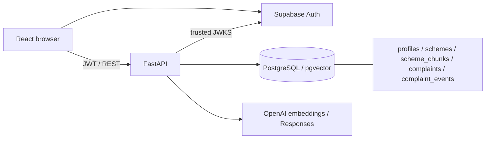

# JanSeva AI

An independent citizen-assistance portfolio project: discover public schemes with cited evidence, create internal civic complaints, and review their history with an assigned officer. JanSeva does not file government grievances or verify government resolution.

**Release status (2026-11-19): PARTIALLY VERIFIED.** Local code, browser journeys and build are tested; live database, authenticated Supabase sessions, OpenAI and private Storage persistence remain blocked by missing credentials. Read [the latest main integration verification](docs/MAIN-PUSH-VERIFICATION.md), [the initial repair report](docs/FINAL-JANSEVA-BUG-FIX-REPORT.md) and [bug audit](docs/final-bug-audit.md). Earlier release reports describe historical states.

## Technology and architecture

- Frontend: React 19, JavaScript, Vite 8, React Router, existing CSS/Tailwind utilities, Lucide icons and Supabase JavaScript client.
- Backend: Python, FastAPI, Pydantic, SQLAlchemy 2, psycopg, PyJWT and httpx.
- Services: PostgreSQL with pgvector, Supabase Auth with asymmetric signing keys, and OpenAI embeddings/Responses through server-side HTTP calls. LangGraph supplies finite read-only agent routing; no separate vector database.
- Tests: pytest, Node test runner and Playwright/Chromium. SQLite and a local Auth provider double are used only in isolated tests.



## Installation

Use Python 3.11+ and a Vite-compatible Node version (20.19+ or 22.12+). Verification used Python 3.12.5, Node 24.19.0 and npm 11.17.0. PowerShell commands below run from the repository root; use `.venv/bin/python` and `npm` equivalents on Unix.

```powershell
python -m venv .venv
.\.venv\Scripts\python.exe -m pip install -r services/api/requirements.txt
if (-not (Test-Path services/api/.env)) { Copy-Item .env.example services/api/.env }
if (-not (Test-Path apps/web/.env)) { Copy-Item apps/web/.env.example apps/web/.env }
npm.cmd ci --prefix apps/web
Set-Location apps/web
npx.cmd playwright install chromium
Set-Location ../..
```

Never commit filled `.env` files. The backend loads `services/api/.env`; process environment takes precedence. Vite reads `apps/web/.env` and needs a restart after changes.

## Configuration

| Variable | Location and purpose |
|---|---|
| `DATABASE_URL` | Server: actual PostgreSQL connection; no production fallback database |
| `SUPABASE_URL` | Server: trusted project URL for JWT issuer and JWKS |
| `SUPABASE_SERVICE_ROLE_KEY` | Server only: private evidence upload/signing and optional operator provisioning; accepts the project's secret API key or legacy service-role JWT |
| `OPENAI_API_KEY` | Server only: embeddings and answer selection |
| `EMBEDDING_MODEL`, `EMBEDDING_DIMENSIONS` | Server: available model and actual positive output dimension |
| `LLM_MODEL` | Server: available Responses model supporting strict JSON-schema output |
| `RAG_MIN_SCORE` | Server: cosine relevance cutoff, default 0.35; needs live calibration |
| `EVIDENCE_MAX_BYTES` | Server: 5242880 bytes (5 MB) default; align private bucket limit when changing |
| `CORS_ORIGINS` | Server: comma-separated exact origins; defaults to localhost and 127.0.0.1 on port 5173 |
| `DEMO_CITIZEN_EMAIL`, `DEMO_OFFICER_EMAIL` | Operator: the two real demo identities |
| `DEMO_CITIZEN_PASSWORD`, `DEMO_OFFICER_PASSWORD` | Operator: required for new identities; never hardcoded or printed |
| `DEMO_CITIZEN_USER_ID`, `DEMO_OFFICER_USER_ID` | Optional server assignment pair: actual UUIDs printed by setup |
| `VITE_API_BASE_URL` | Browser: API origin, normally `http://127.0.0.1:8000` |
| `VITE_SUPABASE_URL`, `VITE_SUPABASE_PUBLISHABLE_KEY` | Browser: same Auth project and public key only |

Supabase must use ES256 or RS256 signing keys; legacy HS256 tokens are unsupported. Never expose database, service-role or model credentials in `VITE_*`. No real demo passwords are distributed.

## Database, demo accounts and corpus

Use only the requested development project `https://rmexxrdtqszlnsndcrpj.supabase.co` for both Supabase URL variables. The supplied public frontend configuration is set in the ignored local file. Six backend variables remain blank until supplied securely: `DATABASE_URL`, `SUPABASE_SERVICE_ROLE_KEY`, `OPENAI_API_KEY`, `LLM_MODEL`, `EMBEDDING_MODEL`, `EMBEDDING_DIMENSIONS`. Never copy values from another project. Use the rotated database password; URL-encode password characters or construct the URL with `sqlalchemy.engine.URL.create` in a private local helper. Do not print the result.

Run read-only checks first:

```powershell
$env:PYTHONPATH = 'services/api'
.\.venv\Scripts\python.exe -m app.scripts.verify_services
.\.venv\Scripts\python.exe -m app.scripts.check_db
```

**The following commands write schema/data or provision accounts. Only run them after confirming the exact development target, backup/recovery arrangements and migration approval. They were not run against a hosted project during this repair.** Review migration `20261118223800_complaint_evidence_and_submissions.sql`, including the private `complaint-evidence` bucket and restrictive browser policy, before applying it. No migration or seed runs during API startup.

After that approval and actual server configuration:

```powershell
$env:PYTHONPATH = 'services/api'
.\.venv\Scripts\python.exe -m app.scripts.migrate
.\.venv\Scripts\python.exe -m app.scripts.migrate_schemes
.\.venv\Scripts\python.exe -m app.scripts.check_db
.\.venv\Scripts\python.exe -m app.scripts.setup_demo
# Copy printed provider-issued citizen/officer UUIDs into services/api/.env.
# Restart the API after setting this explicit assignment pair.
.\.venv\Scripts\python.exe -m app.scripts.ingest_schemes --validate-only
.\.venv\Scripts\python.exe -m app.scripts.ingest_schemes
.\.venv\Scripts\python.exe -m app.scripts.ingest_schemes
.\.venv\Scripts\python.exe -m app.scripts.evaluate_schemes
```

The evidence/submission upgrade adds two tables with RLS and API-only access, a private bucket, and a restrictive storage policy. Migration 001 creates the other tables, constraints and access policies; the same `app.scripts.migrate` command also applies migration 003 to widen existing complaint categories without deleting records. Migration 002 enables pgvector and vector metadata through `app.scripts.migrate_schemes`. Operators need the corresponding database privileges. Setup provisions Arjun Mishra as citizen and R. Singh as officer using real Supabase IDs and database-controlled roles. Optional `app.scripts.seed_demo` inserts twenty explicitly synthetic complaints; new submissions do not require seeding. Never deploy the test-only server entrypoint.

A verified first-time user now receives a server-owned citizen profile automatically; officer access still requires an operator-assigned database role. For the combined-branch audit, validation and operator helper instructions, see [docs/combined-work-review.md](docs/combined-work-review.md). Earlier phase documents are historical verification records.

Only the configured demo citizen's **new** complaints are assigned to the configured officer. Both profiles must exist and the assignee must be an officer. Absent assignment leaves tickets unassigned; partial/invalid configuration fails closed. This grants no other user's access and does not reassign historical tickets.

The checked-in corpus contains **12 schemes and 12 reviewed source notes**: PM-KISAN, NMMSS, PMSBY, PMJJBY, APY, Sukanya Samriddhi, PM Vishwakarma Punjab Ashirwad, IGNOAPS, IGNWPS, IGNDPS and PM-SYM. These are file counts, not live database counts. See [source provenance and currency limits](data/README.md).

## Running

```powershell
# Repository root, terminal 1:
.\.venv\Scripts\python.exe -m uvicorn app.main:app --app-dir services/api --reload
# Terminal 2:
Set-Location apps/web
npm.cmd run dev
```

Open `http://127.0.0.1:5173`; API docs: `http://127.0.0.1:8000/docs`. `/api/health` reports process health, not dependency readiness.

## Main API endpoints

| Method/path | Behavior |
|---|---|
| `GET /api/health` | Process health |
| `GET /api/me` | Authenticated database profile/role |
| `GET /api/schemes` | Stored schemes; optional query, state, category and limit |
| `POST /api/schemes/ask` | Retrieved, validated evidence answer and citations; bounded user-question history |
| `POST /api/schemes/eligibility` | Deterministic `POTENTIAL` / `NOT_MATCHED` / `NEEDS_INFO` screening |
| `POST /api/agent/message` | Read-only scheme / complaint / mixed / clarification routing |
| `POST /api/complaints/analyze` | Citizen-only AI draft and category advice; own-ticket similarity hints |
| `POST /api/complaints` | Citizen creates complaint/event atomically; UUID `Idempotency-Key` makes retries safe |
| `GET /api/complaints` | Own tickets or assigned queue; optional status, `limit` (1?100), `offset`; UI clearly limits loaded history to 1,000 tickets |
| `GET /api/complaints/{id}` | Authorized detail and audit history |
| `PATCH /api/officer/complaints/{id}` | Assigned officer advances one internal step |
| `PATCH /api/officer/complaints/{id}/routing` | Assigned officer changes internal category/recommended department with an audit event |
| `GET /api/complaints/evidence-config` | Public allowed-image types and configured size limit |
| `POST /api/complaints/{id}/evidence` | Owner-only raw image bytes, image `Content-Type`, encoded `X-Filename` |
| `GET /api/complaints/{id}/evidence` | Authorized metadata; no public object paths |
| `GET /api/complaints/{id}/evidence/{evidence_id}/access` | Owner/assigned-officer access link, 300-second lifetime |
| `PATCH /api/complaints/{id}/official-ref` | Owner records an explicitly unverified official reference |

See [API contract](docs/api-contract.md). Complaint edit/delete and government submission are not implemented.

## RAG and complaint workflows

Ingestion validates curated metadata and official HTTPS URLs, chunks reviewed evidence, calls real embeddings and stores compatible vectors. Retrieval embeds the question and uses exact pgvector cosine distance (`<=>`) against active passages. The Responses model selects complete stored paragraphs under a strict schema. Local checks reject invented text, unknown chunks and changed URLs. Citations describe reviewed summaries, not verbatim government quotes. Insufficient evidence returns uncertainty; an unavailable LLM can return a labeled extractive fallback. Embedding/database failures return errors, never fake vectors. A deterministic screening engine checks limited conditions from the eight reviewed records. Missing facts are explicit; a potential match is never an eligibility guarantee. The profile editor stays in memory for the session. Live retrieval relevance and ingestion idempotence still need the configured evaluation.

Complaints use database UUIDs, authenticated ownership, real timestamps and atomic events. The only progression is `LOCAL_SUBMITTED -> UNDER_REVIEW -> IN_PROGRESS -> RESOLVED`. Officer authorization requires a verified session, database role and assignment. Filing starts at `NOT_FILED`; a citizen reference is only `USER_REPORTED_FILED`, never verified official submission or resolution.

## Security and limitations

JWT signatures, issuer, audience, required claims and expiry are validated against trusted JWKS. Roles come from database profiles, never a React role selector. Owner/assignment checks protect complaint reads and updates. Request validation, parameterized SQL, atomic writes, sanitized errors and explicit CORS origins are present. Offline token verification does not provide immediate session revocation.

Public AI requests (semantic scheme queries, `/schemes/ask`, `/agent/message`, and protected complaint analysis) share an in-process limit: **10 per client per minute, 30 total per minute, and 2 concurrent requests**. Excess work receives 429 with `Retry-After`; plain stored-scheme listing does not consume this budget. These limits reset on restart and are separate for each worker: shared quotas and billing controls are still required before public deployment. Other limits: hosted schema/Storage/model integration is not yet verified; Python dependency ranges have no lockfile; a frontend bundle-size advisory remains; draft photos and read marks are session-only; voice, GPS, translation, formal SLA targets and government integration remain unavailable and clearly labelled. Activity notifications are derived from persisted accessible complaint events, not a fabricated feed. Related officer-ticket groups use category/locality rules, not model confidence. Process crashes or lost Storage responses can leave orphan objects; failed cleanup logs a safe operational code for manual reconciliation. Signed links can be shared until their five-minute expiry. Existing historical demo credentials must be rotated by their owner if they were real; preserved Git history was not rewritten.

## Measured verification and demo

```powershell
.\.venv\Scripts\python.exe -m pytest -q
npm.cmd --prefix apps/web run test:client
npm.cmd --prefix apps/web run test:e2e
npm.cmd --prefix apps/web run build
```

The current exact results and intermediate failures are recorded in [the final report](docs/FINAL-JANSEVA-BUG-FIX-REPORT.md). Browser tests run real Vite/FastAPI processes with isolated SQLite, a signed-token Auth double and an explicit Storage double. Provider fixtures and local photo persistence are not evidence of hosted integrations. See [mobile photo evidence](docs/screenshots/final/mobile-evidence.png), [read-only service probes](docs/service-verification.json), [normal API restart checks](docs/backend-process-verification.json), and [official URL reachability](docs/source-url-verification.json).

To repeat the safe source check:

```powershell
$env:PYTHONPATH = 'services/api'
.\.venv\Scripts\python.exe -m app.scripts.check_sources --output docs/source-url-verification.json
```

After setup, sign in as Arjun, load schemes, ask a question and open its official citation. Submit a complaint, retain the returned UUID, check My Requests and refresh. In a separate browser profile, sign in as R. Singh, open the assigned UUID and advance its status with a note. Refresh Arjun's tracking page and confirm persistent status/history. Then run the live gate:

```powershell
$env:JANSEVA_LIVE_RAG = '1'
.\.venv\Scripts\python.exe -m pytest -q services/api/tests/test_schemes_live.py
Remove-Item Env:JANSEVA_LIVE_RAG
```

This historical live gate writes/ingests the corpus and uses billable model calls; obtain development-data write approval first. It has **not passed here**, where real configuration is absent. Complete live gates before claiming the AI MVP is fully verified. See [release evidence](docs/release-review.md), [interview notes](docs/interview-notes.md), and [archived Phase 0 audit](docs/phase-0-audit.md).


## Complaint evidence workflow

Select an optional JPEG, PNG or WebP (default 5 MB), review the complaint, then explicitly confirm the internal ticket. The backend verifies JWT and ownership, bounds streamed bytes, checks actual image format/pixels, strips image metadata, and generates the object path. The bucket must be private. Metadata is persisted separately from the complaint; evidence failure retains the ticket and selected file with a photo-only retry. Tracking and officer details request fresh private access links. All government filing remains the citizen's explicit external action.

Pillow is the only added runtime dependency, for actual image decoding and validation. Uploads use binary bodies through existing httpx rather than introducing a second Supabase SDK. The focused citizen assistant uses the existing OpenAI Responses REST integration. The homepage navigator preserves Developer A's finite LangGraph workflow, source validation, stored-rule eligibility and explicit draft-transfer actions.


## Integrated Developer A scheme navigator

The merged main branch adds the versioned 12-scheme corpus, evidence-backed rule evaluation, profile editor, citation drawer, validated LangGraph tool routing and labelled lexical fallback over real stored chunks. See [RAG implementation](docs/developer-a-phase-1-rag.md) and [scheme UI implementation](docs/developer-a-phase-2-ui.md). The homepage uses `/api/agent/message`; the complaint-page citizen composer uses `/api/agent/conversation` with bounded user history. The complete stored-rule assessment uses `/api/schemes/eligibility`; the limited eight-record quick screening remains `/api/schemes/screen`. Both approaches require official review and never guarantee eligibility.
